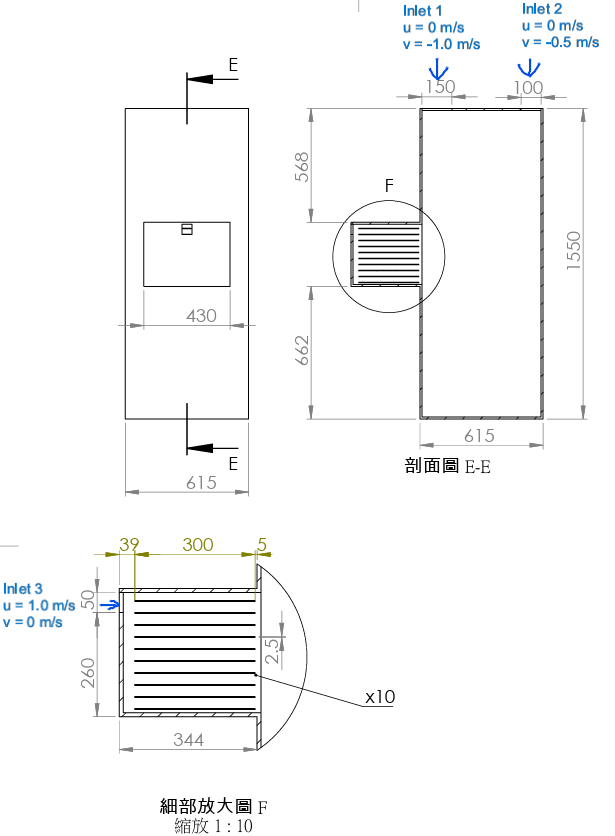

# FOUP Simulation
The program here simulates the impact of airborne moisture on a semiconductor FOUP.

The primary goal of this code is to observe whether simulations using variable Cv or constant Cv yield more accurate data, or if there is no significant difference between the two.

Initially, I ran the simulation on a CPU mainly to quickly verify that my code was free of bugs.
Once everything checked out, I ported the code to a GPU for parallel computing to accelerate the computation speed.

Additionally, I experimented with different solvers and limiters for 2nd_Order spatial reconstruction.
Although different solvers and limiters produce slightly different results, certain details in those variations may provide valuable insights.

## Domain
The smaller rectangle on the left represents the FOUP, while the larger rectangle on the right represents the ME.

## Initial condition
X and Y direction velocity = 0 (everywhere)

mass fraction and Relative Humidity = 0 (everywhere)

T = 300 K (everywhere)

P = 1 atm (everywhere)

## Boundary condition
There are 3 inlet and  1 outlet in this simulation.

First is a small opening at the top-left corner (x = 0 & 662 ≤ y ≤ 982 mm) of the FOUP, through which dry air u = 1.0 m/s, RH = 0 % is blown in.

The remaining two small openings are located at the very top of the ME. The left opening (344 mm ≤ 𝑥 ≤ 494 mm) acts as an air curtain,
blowing dry air downward at 𝑢 = 0 m/s, 𝑣=−1.0 m/s, and RH=0.

The right opening (859 mm ≤ 𝑥 ≤ 959 mm) serves as the moisture inlet, introducing humid air at 𝑢 = 0 m/s, 𝑣 = −0.5 m/s, and RH = 30 %.

The bottom of the ME is completely open, acting as a wall-free outlet.

